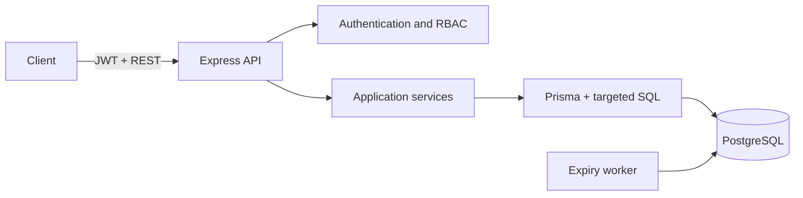
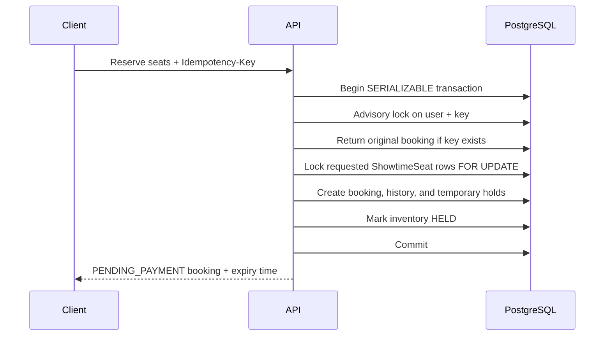

# System Overview

## Runtime topology

The API is stateless. Multiple API instances can serve requests because PostgreSQL owns the booking truth, locks, and constraints. The worker can run in a separate process; its expiry operation is safe to retry.

## Module boundaries

| Module | Owns |
| --- | --- |
| `auth` | registration, password hashing, JWT issuance |
| `admin` | movies, theatres, screens, seats, showtimes, initial seat inventory |
| `catalog` / `showtimes` | customer-facing browse and seat-map reads |
| `bookings` | reservation transaction, state transitions, cancellation, expiry |
| `payments` | mock payment confirmation and payment idempotency |
| `jobs` | scheduled discovery of expired pending bookings |

## Reservation sequence

No payment-provider call occurs while database rows are locked. Confirmation is a separate transaction.

