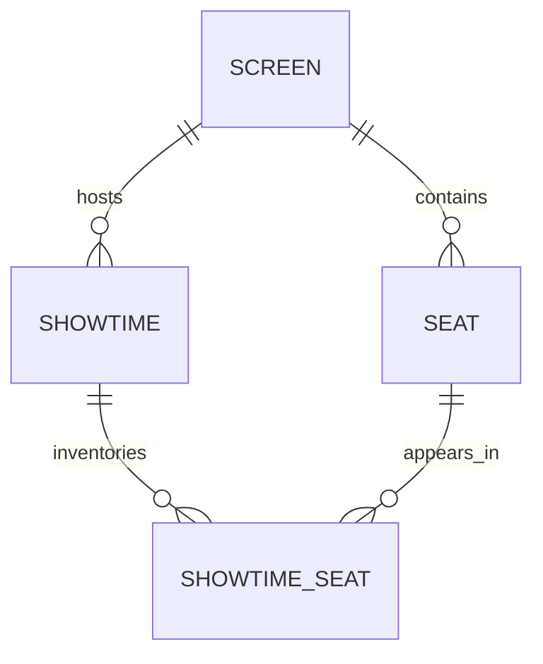

# Domain Modeling: Physical Seats vs Inventory

`Seat` is a physical chair in a screen. `ShowtimeSeat` is that chair's availability for a particular showing.

The constraint `UNIQUE(showtimeId, seatId)` ensures one shared inventory row exists for A1 at a given showing. A1 at a later showing is a different inventory row and can be available independently.

`BookingSeat` records what a booking selected and the charged price. `ShowtimeSeat` records current mutable availability. `SeatHold` is a temporary, indexed relationship used by expiry cleanup.

**Trade-off:** pre-creating inventory adds rows—one per seat per showtime—but makes availability a direct, lockable lookup. Calculating availability from bookings at request time is harder to lock and easier to get wrong.

