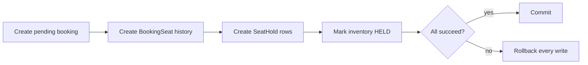

# ACID Transactions

An ACID transaction groups dependent writes so they are treated as one unit.

In this system, a booking must never exist without the seats it claims, and seats must never be held without a booking that owns them. The reservation transaction protects that invariant.

`SERIALIZABLE` isolation is used for high-risk booking mutations. PostgreSQL may abort a transaction when it detects an unsafe concurrent schedule; the service retries that specific serialization failure up to three times.

**Trade-off:** higher isolation can reduce throughput under extreme contention. Seat reservations are short and correctness-sensitive, so correctness wins here.

