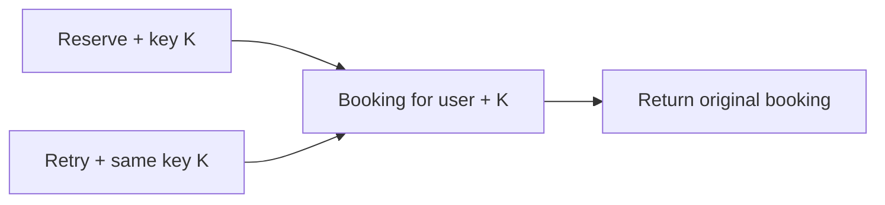

# Idempotent Commands

Network retries are normal: a client can time out after the server commits successfully. Repeating the command must not create a second booking or charge.

`Booking` has `UNIQUE(userId, idempotencyKey)`. The reservation service also takes a PostgreSQL advisory transaction lock derived from the user and key. That closes the small window where two identical retries arrive before either has inserted its booking row.

Payment confirmation has its own idempotency key because it is a separate command and could be retried independently.

**Trade-off:** keys require clients to generate and persist a UUID-like value per command. The alternative is duplicate bookings after an otherwise harmless retry.

