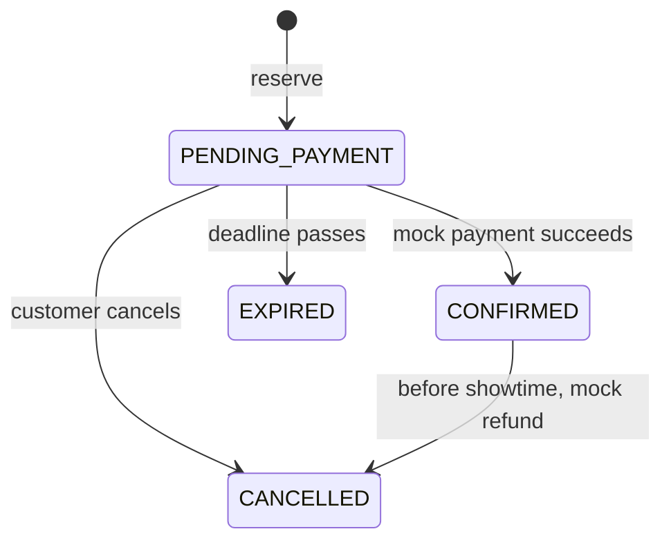

# Booking State Machine

Clients submit commands such as `reserve`, `confirm`, and `cancel`; they never set an arbitrary status.

`assertBookingTransition` is a small pure function with unit tests. Keeping legal transitions in one place prevents endpoints from drifting into inconsistent rules.

On expiry or pending cancellation, held seats become available. On confirmed cancellation, booked seats are released only before the showtime and the mock payment is marked refunded.

