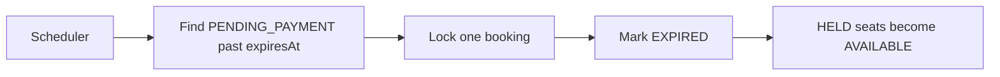

# Background Jobs and Expiry

Temporary holds require cleanup even when no customer sends another request.

The worker may run late or run more than once. It therefore locks the booking and rechecks its state and expiry inside the transaction. A payment that already confirmed is skipped rather than overwritten.

This is **at-least-once** execution: the worker can safely retry work, and duplicate attempts converge on the same correct state.

