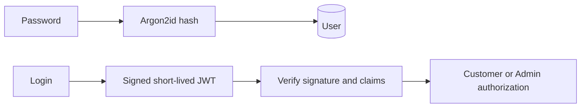

# Authentication and RBAC

Passwords are hashed with Argon2id, not encrypted or stored directly. JWTs identify an authenticated user; RBAC determines whether that user can invoke an admin command.

The server derives the user identity from a verified token. It never accepts a `userId` or `role` supplied in a booking request body.

