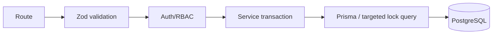

# Project Walkthrough

## Two-minute explanation

> This is a backend-first movie booking system built with TypeScript, Express, PostgreSQL, and Prisma. The core challenge is preventing double booking under concurrent traffic. I modelled availability as pre-created showtime-seat inventory, then reserve seats inside short serializable PostgreSQL transactions using `SELECT FOR UPDATE`. Each request carries an idempotency key, so retries return the original booking. Pending reservations expire through an idempotent worker, and booking transitions are controlled by a state machine rather than client-supplied statuses.

## Architecture walkthrough

Start with the reservation flow, then open `src/modules/bookings/booking.service.ts`. Explain that ORM queries handle ordinary persistence but targeted raw SQL is used for `FOR UPDATE`, because correctness is more important than hiding database semantics.

## Demo order

1. Start Docker PostgreSQL, migrate, seed, and start API plus worker.
2. Log in as the seeded admin and create a future showtime if desired.
3. Register a customer; browse movie, showtime, and seat map.
4. Reserve A1 with an idempotency key; show A1 as `HELD`.
5. Repeat the request with the same key; show the same booking is returned.
6. Confirm mock payment; show A1 as `BOOKED`.
7. Run the integration test to demonstrate the competing-request guarantee.

