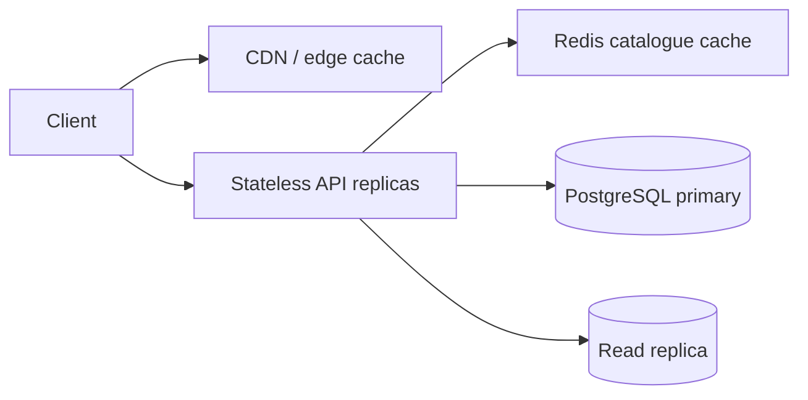

# System Design Follow-ups

## How would you scale reads?

Cache movie and showtime catalogue responses with short TTLs. Keep seat-map availability and all booking writes on the primary database, because they are correctness-sensitive and change frequently.

## How would you scale booking writes?

Keep transactions short, pool connections, and measure lock waits. Partitioning by theatre or showtime date is a possible later step. Do not shard before the primary database has become a measured bottleneck; cross-shard booking logic is materially more complex.

## How would you support live seat-map updates?

Publish an event after a successful transaction commit, then deliver it via WebSocket or Server-Sent Events. Clients must still treat the final reserve command as authoritative because a UI update can be delayed or lost.

## What is intentionally not implemented?

| Capability | Why deferred | What would be added |
| --- | --- | --- |
| Real payment provider | external financial integration and webhooks | provider adapter, webhook signature verification, reconciliation |
| QR ticketing | product feature after booking correctness | signed ticket payload, scanner verification |
| Notifications | asynchronous product concern | transactional outbox plus email/SMS worker |
| Redis cache | PostgreSQL handles current local scale | cache invalidation and read metrics first |
| WebSocket seat updates | REST still guarantees correctness | event outbox and reconnect strategy |
| Rate limiting | deployment-specific edge concern | reverse proxy or Redis token bucket |

