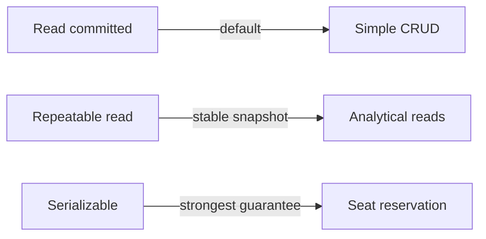

# PostgreSQL and SQL Interview Prep

## Isolation levels

This project uses `SERIALIZABLE` for booking mutations because selling a seat twice is worse than retrying a short transaction. PostgreSQL can abort a transaction with a serialization error; the service retries that bounded, known failure.

## Likely questions

**What is a deadlock?** Two transactions each hold a lock the other needs. PostgreSQL detects one and aborts a participant. This service sorts seat IDs before locking, which gives overlapping requests the same lock order and reduces deadlocks.

**What is the difference between a unique constraint and an index?** A unique constraint enforces a rule and usually creates an index. A non-unique index only accelerates reads; it does not protect correctness.

**How would you investigate a slow query?** Capture the actual query and parameters, use `EXPLAIN (ANALYZE, BUFFERS)`, compare estimated versus actual row counts, add or adjust an index only for the observed access pattern, then measure again.

## Practice

Explain why `UNIQUE(showtimeId, seatId)` is a correctness rule while `INDEX(status, expiresAt)` is a worker-performance decision.

