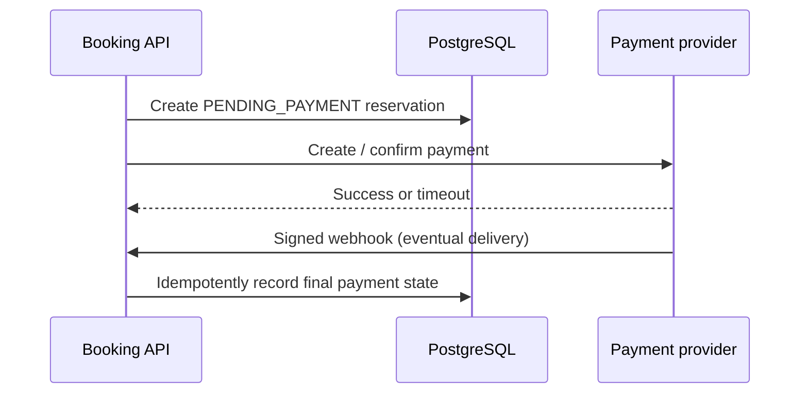

# Payments and Distributed Systems Interview Prep

## The real-payment problem

The mock payment stays in one transaction because it has no external side effect. A real provider cannot be rolled back by PostgreSQL. The system would need provider idempotency keys, signed webhooks, reconciliation, and an outbox for reliable event publishing.

## Likely questions

**What if the provider charged the card but your API crashed?** Never assume a timeout means failure. Store a provider reference, accept idempotent webhooks, query the provider when necessary, and reconcile uncertain payments.

**What is a saga?** A business workflow spanning multiple services or transactions, where failures are handled by compensating actions rather than one global database transaction. A refund is a typical compensation.

**Why not call the provider while holding seat locks?** Network calls are slow and unpredictable. Long transactions increase lock waits and contention. Hold inventory first, call the provider outside locks, then process a confirmed result safely.

## Practice

Describe the exact new tables or fields you would add for a real payment provider before writing integration code.

