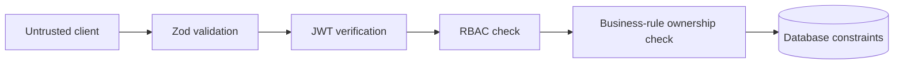

# Security Interview Prep

## Request trust boundary

## Likely questions

**Why hash passwords with Argon2id?** It is intentionally slow and memory-hard, which makes offline password-guessing attacks more expensive. Passwords are never reversible application data.

**What does a JWT prove?** It proves that a trusted issuer signed claims which have not expired. It does not replace authorization checks, ownership checks, token revocation policy, or secure storage by the client.

**How would you add refresh tokens?** Store only a hash of an opaque refresh token, rotate it on use, track device/session metadata, and revoke it on logout or suspected compromise. Keep access tokens short-lived.

**What is missing before public deployment?** HTTPS termination, CORS policy, rate limiting, security headers, request-size limits, secret management, dependency scanning, audit logs for admin actions, and alerting.

## Practice

Explain why a booking endpoint derives `userId` from the verified JWT instead of accepting it in JSON.

