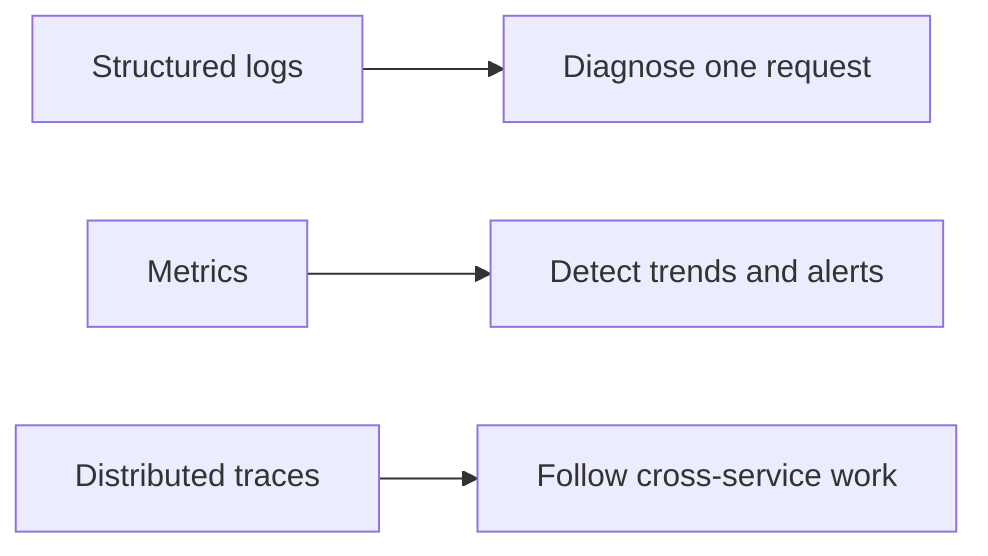

# Observability Interview Prep

## Three pillars

The API already emits request logs and accepts `X-Request-Id`. In a production deployment, add JSON logs to a central collector and attach the request ID to booking, payment, and worker records.

## Metrics to add

- reservation attempts, successes, `409` conflicts, and transaction retries;
- lock wait time and database connection-pool saturation;
- bookings expired per worker run and worker lag;
- payment confirmation outcomes and webhook failures;
- p50/p95/p99 endpoint latency and error rate.

## Likely questions

**How would you know double booking is happening?** It should be prevented, so alert on violated invariant signals: duplicate-seat constraint errors, unexpected state transitions, or a reconciliation query that finds more than one active owner.

**What should never be logged?** Passwords, JWTs, authorization headers, raw payment data, and unnecessary personally identifiable information.

