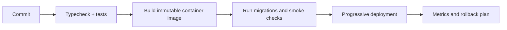

# Deployment and Migrations Interview Prep

## Safe delivery path

## Likely questions

**Why are migrations versioned SQL files?** They make schema changes repeatable, reviewable, and ordered across environments. The application version and database version can be reasoned about together.

**How do you make a breaking schema change safely?** Expand first: add a nullable column or new table, deploy code that writes both forms, backfill, switch reads, then remove the old form later. Avoid one deployment that renames or drops a live column used by old servers.

**Can you roll back a migration?** Prefer forward fixes in production. Data-destructive rollback is risky; plan migrations to be backward compatible and keep backups.

## Practice

Explain why deleting a movie, screen, or confirmed booking is weaker than retaining history and using cancellation states.

