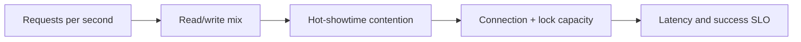

# Capacity and Performance Interview Prep

## Estimation method

Start with assumptions, state them clearly, then calculate. For example: catalogue reads may be hundreds of times more frequent than reservations; a blockbuster showtime creates a small number of hot `ShowtimeSeat` rows while most inventory remains independent.

## Likely questions

**What is the bottleneck?** Usually database connections, lock contention on popular seats, or unbounded catalogue reads—not the Express route handler itself. Measure before adding infrastructure.

**How would you load test?** Seed a realistic theatre and showtime distribution, run ordinary browse traffic plus a controlled burst against the same seat, record success/conflict counts, p95 latency, lock waits, and database CPU.

**When would you add Redis?** For cacheable catalogue data, rate limiting, or pub/sub. Not as the first source of booking correctness.

