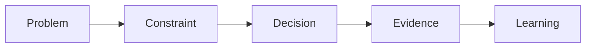

# Behavioral and Project Ownership Questions

## Tell me about this project

Use this structure:

1. **Problem:** booking systems must avoid selling one seat twice.
2. **Constraint:** requests can race, retry, and fail halfway through.
3. **Decision:** PostgreSQL transactions, row locks, constraints, idempotency, and expiry.
4. **Evidence:** concurrency integration test and migration-level constraints.
5. **Learning:** correctness belongs at the database boundary, not only in application code.

## Questions to rehearse

- What was the hardest design decision, and what alternatives did you reject?
- Describe a bug you anticipated before production.
- What would you build differently with another month?
- What assumptions did you make about cancellation and payment?
- Which part would fail first under 100x traffic?

Answer honestly. State what is implemented, what is mocked, and what you would add next. Strong candidates explain boundaries; they do not claim a small project has solved every production concern.

