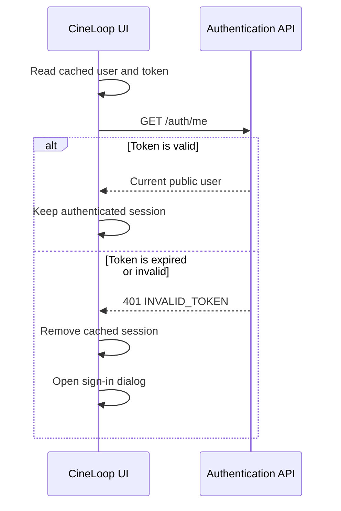

# Step 3 — Authentication and RBAC

## Concept

**Authentication** answers “who are you?” **Authorization** answers “are you allowed to do this?” A JWT proves a user has authenticated; role-based access control (RBAC) limits which commands that identity can execute.

Passwords are never stored as plain text. Store a slow password hash and compare it during login.

## Application in this project

Customers may browse, reserve, pay, and inspect their own bookings. Admins may create movies, theatres, screens, and showtimes. A customer cannot become an admin by placing `role: ADMIN` in JSON.

## Code together

1. Define registration and login request validation.
2. Hash passwords with Argon2 and issue a short-lived JWT after login.
3. Add authentication middleware that attaches the verified user to the request.
4. Add role middleware and protect one admin-only route.
5. Write tests for missing, invalid, customer, and admin tokens.

## Review questions

1. Why is a password hash different from encryption?
2. Why must the server verify a role instead of trusting client JSON?
3. Which status code should an unauthenticated request receive: 401 or 403?

## Session expiry in the frontend

CineLoop access tokens expire after 15 minutes. The browser may still contain an
older token after it expires, so displaying a cached user is not proof that the
session is valid.

On application startup, the frontend validates a stored token with:

```text
GET /auth/me
Authorization: Bearer <access-token>
```



Every protected action handles `401` the same way because a valid session can
expire while the application remains open.

A production system would normally combine short-lived access tokens with
rotating refresh tokens stored in secure, HTTP-only cookies. This project uses
explicit reauthentication to keep the authentication boundary small and visible.

## Completion check

A customer can log in, an admin-only endpoint rejects that customer with `403`, and no response ever returns a password hash.
