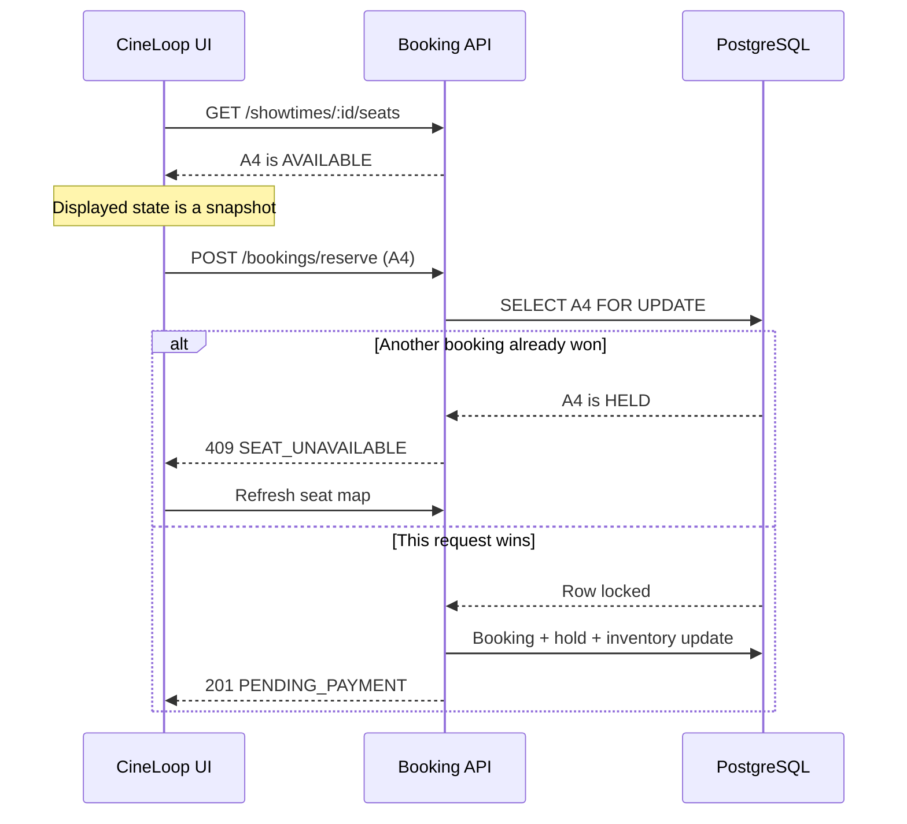
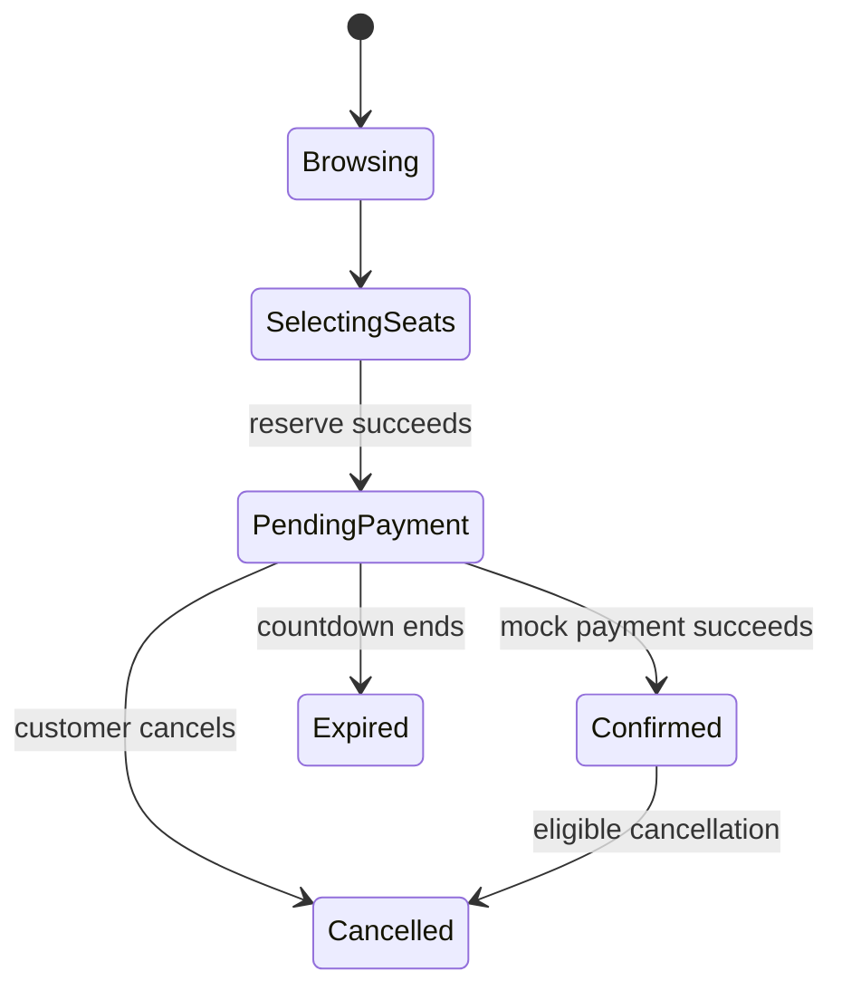

# Lesson 10: Turning Backend Correctness into a Recruiter Demo

## Concept

A frontend does not make the booking algorithm correct. It makes the backend's guarantees visible.

The most important rule is:

> The seat map is a snapshot; the reservation command is authoritative.

The browser may display a seat as available while another customer is reserving it. The UI must therefore treat `409 SEAT_UNAVAILABLE` as an expected business outcome, refresh inventory, and ask the customer to choose again.

## Application in CineLoop

CineLoop has two data modes:

1. **Live API mode** calls the real Express service at `127.0.0.1:3000`.
2. **Demo mode** keeps the hosted portfolio explorable when the local backend is not publicly reachable.

The mode is always visible. This avoids pretending that simulated browser data is a production backend.

The customer flow maps directly to backend state:

## Why local CORS is narrow

The API accepts cross-origin browser requests only from local `localhost` or `127.0.0.1` development origins. It does not use a global `*` policy.

This is enough for separate frontend and backend development servers without weakening the production security boundary. A deployed architecture should use an explicit configured frontend origin or place both services behind one gateway.

## Why the concurrency lab matters

Most demos show only a successful booking. CineLoop deliberately sends two reservation requests for the same `ShowtimeSeat`.

The expected result is:

- one `201 Created`;
- one `409 SEAT_UNAVAILABLE`;
- one HELD inventory row;
- no duplicate confirmed ownership.

That screen lets an interviewer connect the visible result to row locks, serializable transactions, uniqueness constraints, retries, and idempotency.

## Interview questions

### Why not disable the seat in the UI after the first click?

That protects only one browser tab. It cannot coordinate different users, devices, API servers, or retries. The database transaction must own the invariant.

### Why keep demo mode?

The portfolio frontend can be hosted independently, while the Express/PostgreSQL service remains a local system-design project. Demo mode improves accessibility for a recruiter, but it is clearly labelled and the real integration path remains the primary technical evidence.

### What would production add?

- A deployed API and managed PostgreSQL database
- Explicit production CORS origins or a shared gateway
- Real payment provider webhooks and reconciliation
- WebSocket or Server-Sent Event seat updates
- Distributed tracing from browser request ID to database transaction
- Rate limiting, CSP headers, and secret management
- Automated end-to-end tests against an isolated database

## Review checklist

- Does a `409` refresh the seat map?
- Is the hold countdown based on the server's `expiresAt`?
- Does the UI send a new idempotency key for each new command?
- Does retrying the same command reuse its key?
- Are demo and live modes visibly distinguishable?
- Are admin commands hidden from customers and still protected by backend RBAC?
- Can the demo explain why only one concurrent request wins?
