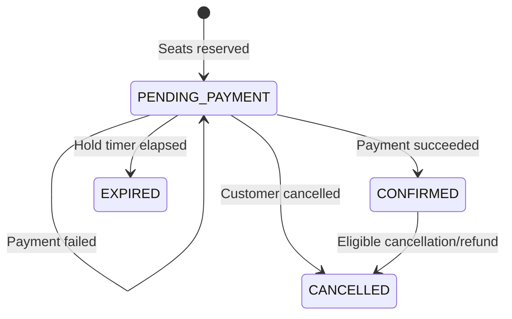
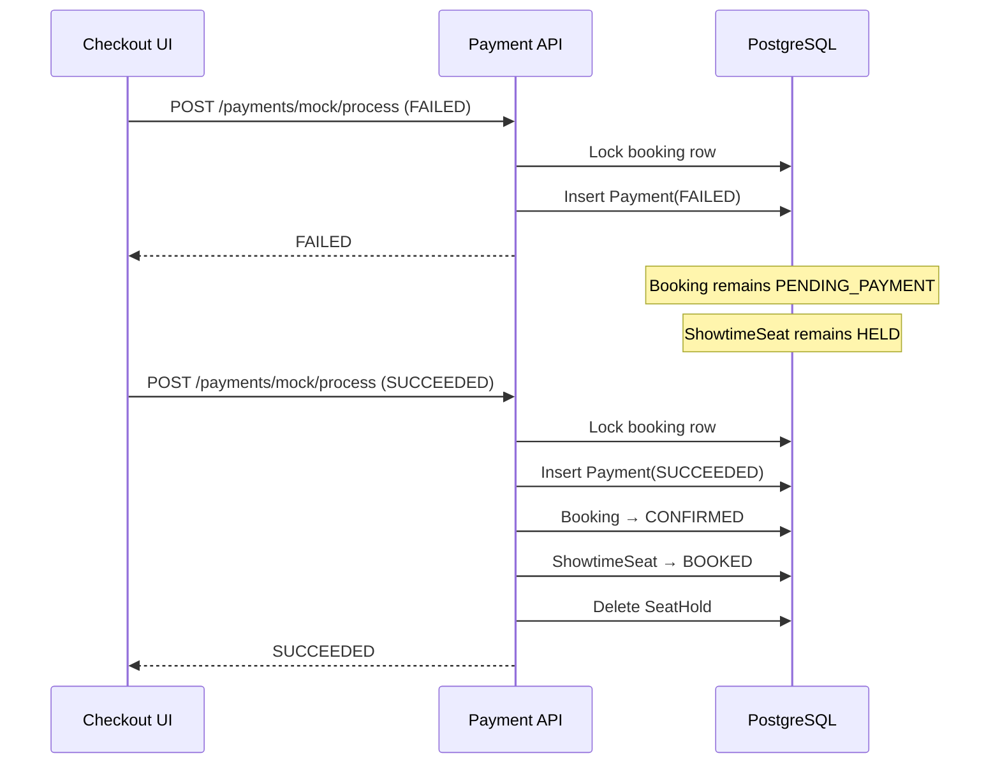
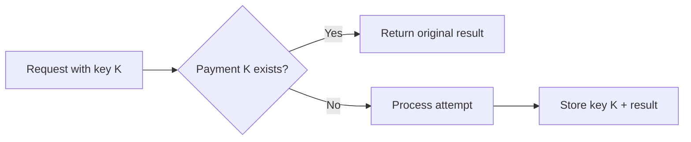
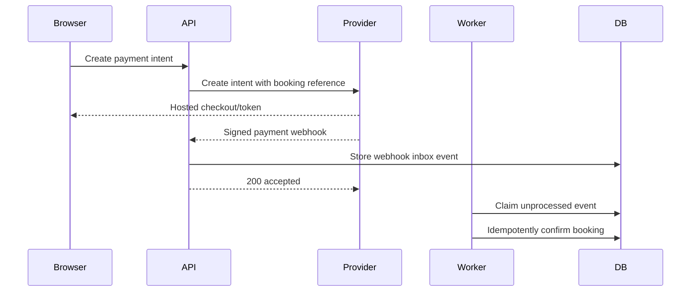

# Lesson 11: Mock Payment Gateway and Reconciliation

## Concept

A payment screen is not the source of truth. The backend owns the booking state, while a payment provider owns the payment outcome.

Those two systems cannot share one database transaction in production. That creates a distributed-systems problem:

- the provider may approve a payment while our API is restarting;
- the browser may close after payment succeeds;
- the provider may send the same webhook more than once;
- the customer may retry after a timeout;
- the seat hold may expire while payment is being attempted.

The mock gateway keeps everything local, but models the same boundaries and state transitions.

## Application in CineLoop

The customer first reserves seats. That creates a temporary booking:



A failed payment does not release the seats immediately. The customer may retry while the original hold is still valid.



## Why every payment attempt has an idempotency key

Networks can lose responses. The client may not know whether a request failed before or after the server processed it.

An idempotency key lets the server return the original payment record instead of creating another attempt:



The same key always represents the same command. A retry after a declined payment uses a new key because it is a new payment attempt.

## Atomic local confirmation

For this mock provider, payment creation and booking confirmation happen in one serializable PostgreSQL transaction.

The successful transaction changes all related state:

```text
Payment.status        = SUCCEEDED
Booking.status        = CONFIRMED
Booking.expiresAt     = null
ShowtimeSeat.status   = BOOKED
SeatHold              = deleted
```

If any write fails, PostgreSQL rolls back all of them. We never commit `Payment = SUCCEEDED` while leaving `Booking = PENDING_PAYMENT`.

## Why My Bookings reloads from the API

The UI may optimistically show success, but it fetches booking history again after a live payment.

That matters because React state is only a view. PostgreSQL is authoritative.

The earlier implementation decided whether to call the live payment API from the currently selected showtime. After a page reload, a pending booking could be opened from My Bookings without a selected showtime. The UI then used the demo-only confirmation path.

The corrected rule derives the path from the booking itself:

- backend UUID booking while Live API is connected → call the real payment API;
- demo booking with a `BK...` identifier → use the portfolio simulation.

This is an example of avoiding hidden UI context when making a domain decision.

## What the mock gateway demonstrates

The checkout supports:

- UPI, card, and wallet test methods;
- explicit approve and decline outcomes;
- a visible processing state;
- safe retry after decline;
- a success receipt with booking and gateway references;
- a direct handoff to the confirmed ticket in My Bookings.

It never asks for real financial information.

## What production would change

A real provider usually uses asynchronous webhooks:



Production additions would include:

- provider-hosted payment fields or tokenization;
- signed webhook verification;
- an inbox table for deduplicating webhook events;
- reconciliation for payments whose booking update was delayed;
- refunds as a separate command and state machine;
- metrics for payment success rate, latency, and unmatched provider events;
- a policy for payments approved after a seat hold expires.

## Interview questions

### Why not trust the browser's success screen?

The browser can close, lose connectivity, or be modified by a user. Only a server-verified provider result can authorize confirmation.

### Why keep a failed Payment row?

It provides an audit trail, supports failure-rate metrics, and helps diagnose retries. The booking remains pending because failure is an attempt outcome, not the end of the hold.

### What happens if two successful attempts race?

Both transactions lock the same booking. Only the first can transition `PENDING_PAYMENT → CONFIRMED`. The other sees a non-pending booking and is rejected. Provider-level idempotency should also prevent duplicate charges.

### Why use a new idempotency key after a decline?

Reusing the old key must return the original declined result. A retry is a new command, so it gets a new key.

### What is the hardest production payment edge case?

The provider approves payment after the seat hold expires. The system needs an explicit policy: extend the hold during payment, reserve compensation inventory, or automatically refund. It must never silently double-book the seat.

## Review checklist

- Does a failed payment leave the booking pending?
- Do held seats remain protected until expiry or cancellation?
- Does a successful attempt atomically confirm payment, booking, and inventory?
- Is every payment command idempotent?
- Can a user process only their own booking?
- Does My Bookings reload authoritative backend state?
- Are real card, UPI, or wallet credentials never collected by the mock UI?
- Can you explain how webhooks would replace the synchronous mock provider?
